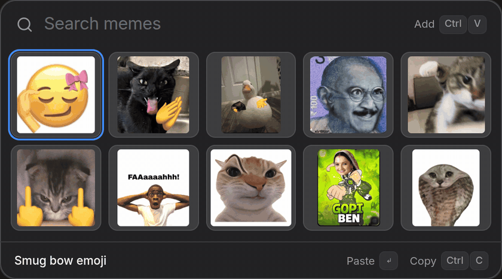
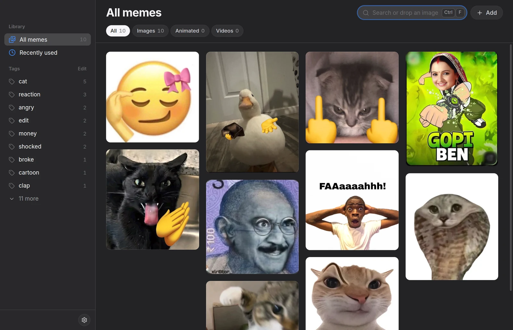
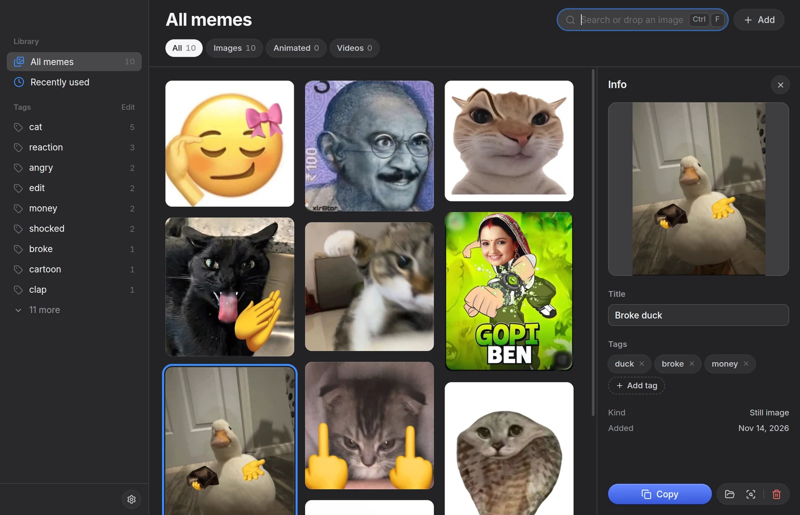
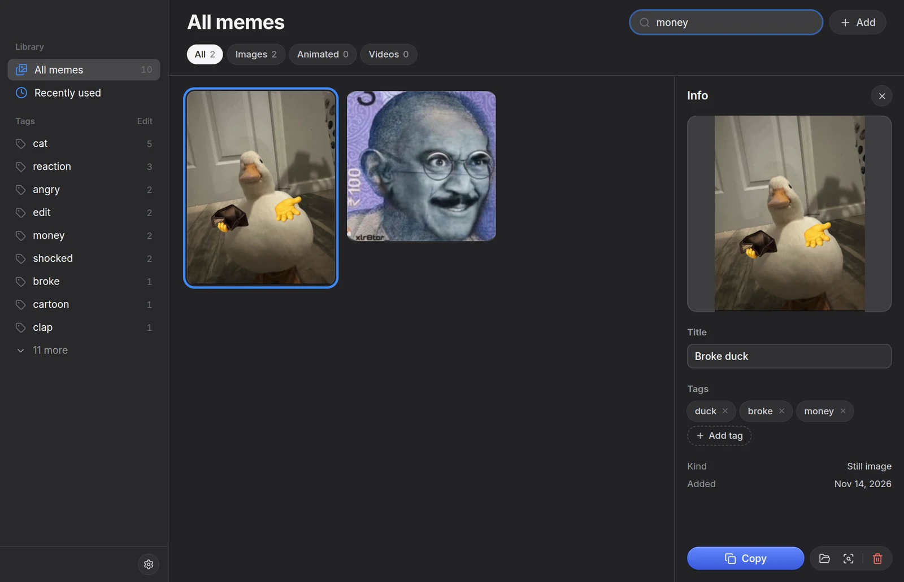
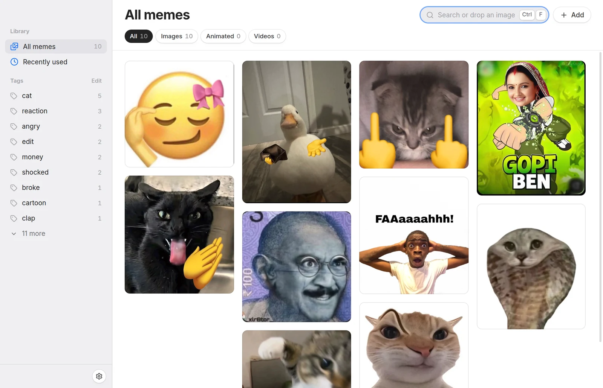

# Memez

A local meme library with a hotkey search popup. Save a meme once, then paste it into any chat
in about two seconds.



Your memes stay in a folder on your computer. The AI that names and tags them runs on your
computer too. Nothing is uploaded.



## Status

Version 1.0.0. It is tested on macOS (Apple Silicon) only. The Linux and Windows builds are
new and not tested yet.

| System                | Build            | State                                                  |
| --------------------- | ---------------- | ------------------------------------------------------ |
| macOS (Apple Silicon) | `.zip`           | Tested                                                 |
| Linux (x64)           | `.AppImage`      | Starts and runs. Local AI does not work yet, see below |
| Windows (x64)         | `.exe` installer | Built, never run on a real machine                     |

If you try Linux or Windows, please open an issue and tell me what broke.

## What it does

- **Hotkey popup.** Press ⌘⇧M (Ctrl+Shift+M on Linux and Windows) from any app. Type, press
  Enter, and the meme is pasted into the app you were in.
- **Images, GIFs and videos.** PNG, JPG, WebP, GIF, MP4 and WebM.
- **Search that forgives typos.** It matches the title, the tags and the text inside the meme.
- **Search by meaning.** "crying" finds a crying cat that has no such tag or title.
- **Local AI titles and tags.** Each new meme gets a title and tags. It never changes a title
  you typed.
- **Find similar, and search by image.** Drop an image on the search field to find memes that
  look like it.
- **Raycast extension** (macOS). Search and paste memes from Raycast.
- **Backup.** A folder backup (iCloud Drive by default on macOS), and zip export and import to
  move to another computer.
- **Light and dark.** It follows the system.







## Install

Download the file for your system from the
[latest release](https://github.com/ramxcodes/memez/releases/latest).

The builds are not signed with a paid developer certificate, so each system shows a warning the
first time. The steps below get past it.

### macOS

1. Unzip the file and move `Memez.app` to `/Applications`.
2. Open Terminal and run:

   ```bash
   xattr -cr /Applications/Memez.app
   codesign --force --deep --sign - /Applications/Memez.app
   open /Applications/Memez.app
   ```

   The first command removes the "downloaded from the internet" flag. The second signs the app
   on your Mac.

3. The first paste asks for Accessibility access (System Settings → Privacy & Security →
   Accessibility). Memez needs it to press ⌘V for you.

After you install a new version, macOS can ask for Accessibility access again. If paste stops
working, remove Memez from that list and add it again.

### Linux

```bash
chmod +x Memez-*.AppImage
./Memez-*.AppImage
```

### Windows

Run `Memez-*-win-x64.exe`. If SmartScreen stops it, choose "More info", then "Run anyway".

## Use

- **Add.** Copy an image, GIF, video or link, then press ⌘V in the library window. You can also
  drop files in. An image copied from a browser is downloaded from its source, so a GIF stays
  animated.
- **Find.** Press the hotkey and type. Click a meme or press Enter to paste it. ⌘1 to ⌘9 paste
  by position, and ⌘C only copies. Before you type, recent memes come first.
- **Quick add.** In the popup, press ⌘V to add the meme on the clipboard.
- **Settings (⌘,).** Change the hotkey, turn Local AI on or off, get or delete models, and
  choose whether picking a meme pastes it or only copies it.

On Linux and Windows, use Ctrl where this page says ⌘. Picking a meme copies it there; paste it
yourself with Ctrl+V.

## Local AI

Two models run on your computer:

- **Florence-2** writes a short title. For GIFs and videos it also reads the text in them.
- **CLIP** picks the tags and powers search by meaning, find similar and search by image.

They download once, about 570 MB, on first launch with Local AI on. The sidebar shows the
progress. Settings has larger models if you want better titles or search. GIFs and videos are
read from a few frames across the whole clip, not only the first frame. Audio is not read.

On macOS, Apple Vision reads the text in still images. On Linux and Windows there is no text
reading for still images yet.

## Raycast (macOS)

Settings → Raycast → **Install** adds two commands. No `npm` and no running process is needed.

- **Search Memes.** A grid of your memes, recent first. Enter pastes, ⌘↵ copies, ⌘⇧V adds the
  meme on the clipboard, ⌘⇧F shows it in Finder. It reads the library folder, so it works when
  Memez is closed. It has no search by meaning.
- **Add Meme from Clipboard.** Adds the copied image, GIF, video or link.

If the commands do not show after Install, run Raycast's "Import Extension" command and pick
`~/.config/raycast/extensions/memez`.

## Where your data is

- Library: `~/Memez`, with `library.json` and a `media/` folder. Plain files, easy to back up.
  Set the `MEMEZ_LIBRARY` environment variable to use another folder.
- Models and settings: the app data folder (`~/Library/Application Support/memez` on macOS).

## Known issues

- **Linux: Local AI crashes.** The image decoder (`sharp`) crashes inside Electron's helper
  process on Linux. The app keeps running and shows "AI tagging failed". Everything else works.
  Turn Local AI off in Settings until this is fixed.
- **Windows: not tested.** The installer is built by CI and has never run on a real machine.
- **Intel Macs:** there is no build yet. Build from source.

## Build from source

You need Node.js 24.

```bash
git clone https://github.com/ramxcodes/memez.git
cd memez
npm install
npm run dev          # run the app
```

Checks:

```bash
npm test
npm run typecheck
npm run lint
```

Build the app for the system you are on. The result is in `dist/`.

```bash
npm --prefix raycast install   # macOS only, once: the app carries the Raycast extension
npm run build:mac
npm run build:linux
npm run build:win
```

To work on the Raycast extension: `cd raycast && npm install && npm run dev`.

### Release

Set the version in `package.json`, then push a tag with the same number:

```bash
git tag v1.0.1
git push origin v1.0.1
```

GitHub Actions builds the macOS, Linux and Windows apps and attaches them to a release.

## How it is built

Electron, React and TypeScript. The models run with
[transformers.js](https://github.com/huggingface/transformers.js) on ONNX Runtime, in their own
process, so a crash in the model runtime cannot close the app. Video and GIF frames are decoded
by the Chromium inside Electron, so there is no ffmpeg.

## Contributing

Issues and pull requests are welcome. Keep changes small, and run the three checks above before
you open a pull request.

## License

[MIT](LICENSE). The memes in the screenshots belong to the people who made them.
