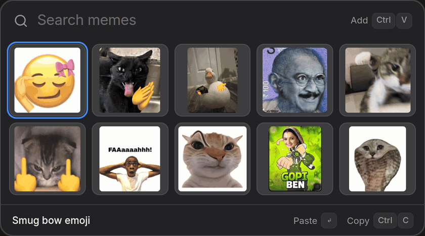
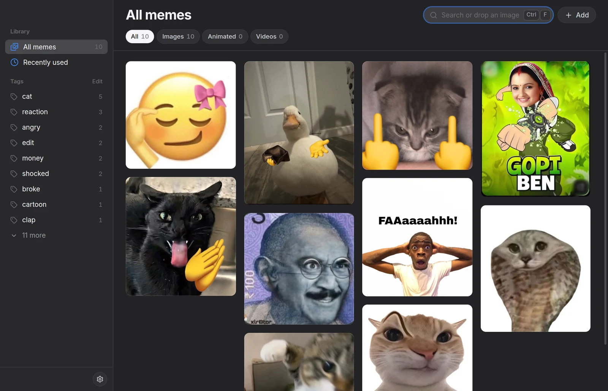
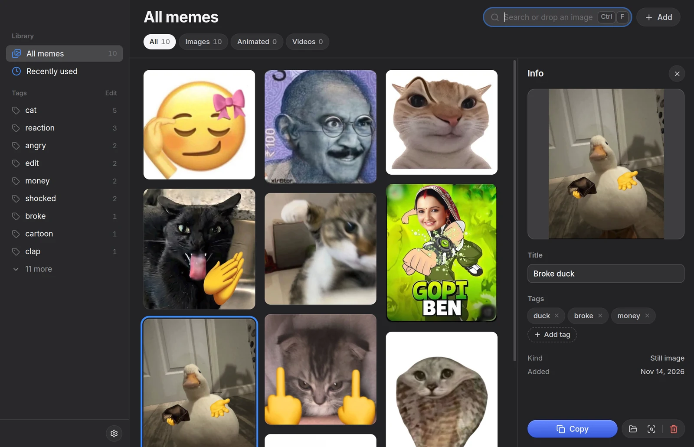
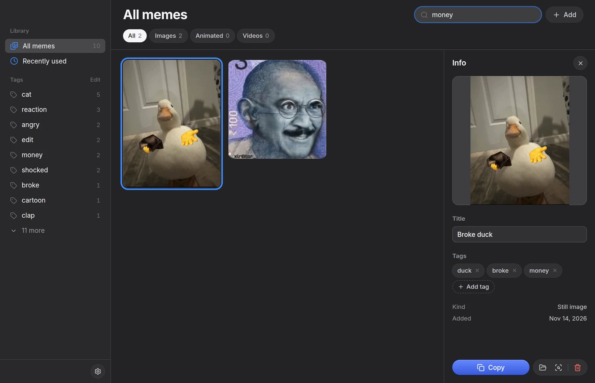
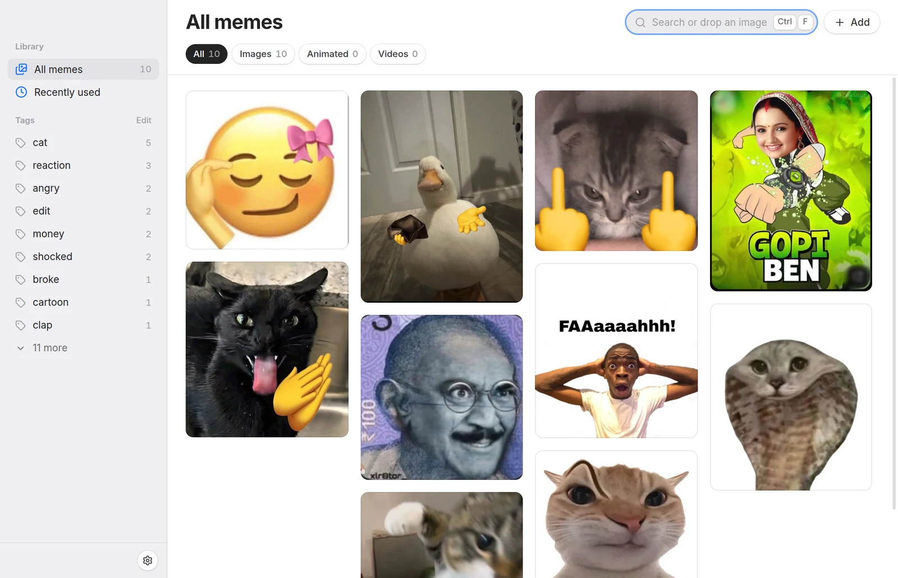

# Memez

A local meme library with a hotkey search popup. Save a meme once, then paste it into any chat
in about two seconds.



Your memes stay in a folder on your computer. The AI that names and tags them runs on your
computer too. Nothing is uploaded.



## Status

Version 1.0.0. It is tested on macOS (Apple Silicon) and, from source, on Arch Linux with
Hyprland (Omarchy). The Linux packages are built and start, but have not been installed and used
day to day yet. The Windows build is not tested.

| System                | Build                           | State                                |
| --------------------- | ------------------------------- | ------------------------------------ |
| macOS (Apple Silicon) | `.zip`                          | Tested                               |
| Arch Linux (x64)      | AUR `memez-bin`, `.pkg.tar.zst` | Works from source, Local AI included |
| Linux (x64)           | `.AppImage`, `.tar.gz`          | Starts and runs                      |
| Windows (x64)         | `.exe` installer                | Built, never run on a real machine   |

If you try Linux or Windows, please open an issue and tell me what broke.

## What it does

- **Hotkey popup.** Press ⌘⇧M (Ctrl+Shift+M on Linux and Windows) from any app. Type, press
  Enter, and the meme is pasted into the app you were in.
- **Images, GIFs and videos.** PNG, JPG, WebP, GIF, MP4 and WebM.
- **Search that forgives typos.** It matches the title, the tags and the text inside the meme.
- **Search by meaning.** "crying" finds a crying cat that has no such tag or title.
- **Local AI titles and tags.** Each new meme gets a title and tags. It never changes a title
  you typed.
- **Find similar, and search by image.** Drop an image on the search field to find memes that
  look like it.
- **Raycast extension** (macOS). Search and paste memes from Raycast.
- **Vicinae extension** (Linux, macOS and Windows). Search and paste memes from Vicinae.
- **Backup.** A folder backup (iCloud Drive by default on macOS), and zip export and import to
  move to another computer.
- **Light and dark.** It follows the system.







## Install

Download the file for your system from the
[latest release](https://github.com/ramxcodes/memez/releases/latest).

The builds are not signed with a paid developer certificate, so each system shows a warning the
first time. The steps below get past it.

### macOS

1. Unzip the file and move `Memez.app` to `/Applications`.
2. Open Terminal and run:

   ```bash
   xattr -cr /Applications/Memez.app
   codesign --force --deep --sign - /Applications/Memez.app
   open /Applications/Memez.app
   ```

   The first command removes the "downloaded from the internet" flag. The second signs the app
   on your Mac.

3. The first paste asks for Accessibility access (System Settings → Privacy & Security →
   Accessibility). Memez needs it to press ⌘V for you.

After you install a new version, macOS can ask for Accessibility access again. If paste stops
working, remove Memez from that list and add it again.

### Arch Linux

From the AUR, with an AUR helper:

```bash
yay -S memez-bin
```

Or download `memez-*-x86_64.pkg.tar.zst` from the release and install it with pacman:

```bash
sudo pacman -U memez-*-x86_64.pkg.tar.zst
```

Both install the `memez` command, a menu entry and the `memez://` link handler. Optional tools:
`wl-clipboard` and `wtype` (Wayland) or `xdotool` (X11) to paste for you, and `tesseract` with
`tesseract-data-eng` to read the text in memes. The AUR package lists them as optional
dependencies; with the `.pkg.tar.zst`, install them yourself:

```bash
sudo pacman -S --needed wl-clipboard wtype xdotool tesseract tesseract-data-eng
```

On Omarchy, use the [Omarchy plugin](#omarchy) instead: it adds a key and a picker in the
shell. Elsewhere, bind a key to `memez --toggle-popup` (Settings shows the exact command). In a
classic `hyprland.conf`:

```ini
bind = SUPER ALT, M, exec, memez --toggle-popup
```

### Ubuntu / Debian

Download `memez_*_amd64.deb` from the release and install it:

```bash
sudo apt install ./memez_*_amd64.deb
```

The package installs the `memez` command, a menu entry and the `memez://` link handler. The
optional tools are listed as recommended packages: `wl-clipboard` and `wtype` (Wayland) or
`xdotool` (X11) to paste for you, and `tesseract-ocr` with `tesseract-ocr-eng` to read the text in
memes.

### Other Linux

```bash
chmod +x Memez-*.AppImage
./Memez-*.AppImage
```

The AppImage does not add a menu entry or the `memez://` link handler by itself. The
`Memez-*-linux-x64.tar.gz` holds the same app unpacked; run `memez` inside it.

### Windows

Run `Memez-*-win-x64.exe`. If SmartScreen stops it, choose "More info", then "Run anyway".

## Use

- **Add.** Copy an image, GIF, video or link, then press ⌘V in the library window. You can also
  drop files in. An image copied from a browser is downloaded from its source, so a GIF stays
  animated.
- **Find.** Press the hotkey and type. Click a meme or press Enter to paste it. ⌘1 to ⌘9 paste
  by position, and ⌘C only copies. Before you type, recent memes come first.
- **Quick add.** In the popup, press ⌘V to add the meme on the clipboard.
- **Settings (⌘,).** Change the hotkey, turn Local AI on or off, get or delete models, and
  choose whether picking a meme pastes it or only copies it.

On Linux and Windows, use Ctrl where this page says ⌘. On Windows, picking a meme copies it; paste
it yourself with Ctrl+V.

On Linux, picking a meme pastes it with `wtype` (Wayland) or `xdotool` (X11), which press
Shift+Insert in the app behind. Without them Memez only copies (`sudo pacman -S wtype`). Wayland
apps cannot grab a global key by themselves, so the hotkey in Settings may do nothing there: bind
a key in your window manager to `memez --toggle-popup` instead. Other flags: `--show` opens the
library, `--hidden` starts in the tray (for autostart), and `memez://add` adds the meme on the
clipboard.

## Local AI

Two models run on your computer:

- **Florence-2** writes a short title. For GIFs and videos it also reads the text in them.
- **CLIP** picks the tags and powers search by meaning, find similar and search by image.

They download once, about 570 MB, on first launch with Local AI on. The sidebar shows the
progress. Settings has larger models if you want better titles or search. GIFs and videos are
read from a few frames across the whole clip, not only the first frame. Audio is not read.

On macOS, Apple Vision reads the text in still images. On Linux,
[Tesseract](https://github.com/tesseract-ocr/tesseract) does, when it is installed
(`sudo pacman -S tesseract tesseract-data-eng`); memes added before you install it are read on the
next launch. On Windows there is no text reading for still images yet.

## Raycast (macOS)

Settings → Raycast → **Install** adds two commands. No `npm` and no running process is needed.

- **Search Memes.** A grid of your memes, recent first. Enter pastes, ⌘↵ copies, ⌘⇧V adds the
  meme on the clipboard, ⌘⇧F shows it in Finder. It reads the library folder, so it works when
  Memez is closed. It has no search by meaning.
- **Add Meme from Clipboard.** Adds the copied image, GIF, video or link.

If the commands do not show after Install, run Raycast's "Import Extension" command and pick
`~/.config/raycast/extensions/memez`.

## Vicinae (Linux, macOS and Windows)

The Vicinae extension is a read-only client for the same library. The Memez app owns the library
and the AI; Vicinae searches what the app already tagged and pastes or copies a meme. Adding from
the clipboard and recent-use updates go back to the app through `memez://` links, so install and
run Memez before using those actions.

```bash
cd vicinae
npm install
npm run build
```

Then open Vicinae and search for **Memez**. For development, run `npm run dev` instead of
`npm run build` while Vicinae is running.

- **Search Memes.** A grid of your memes, recent first. Enter pastes, Cmd/Ctrl+C copies,
  Cmd/Ctrl+Y opens the file, Cmd/Ctrl+Shift+V adds the meme on the clipboard, and
  Cmd/Ctrl+Shift+F shows it in the file browser. It reads the library folder, so it works when
  Memez is closed. It has no search by meaning.
- **Add Meme from Clipboard.** Adds the copied image, GIF, video or link through the Memez app.

Set the extension's **Library Folder** preference to the same folder as the app (`~/Memez` by
default). Video previews use `ffmpeg` on Linux and Windows, and Quick Look on macOS; install
`ffmpeg` if your video tiles show only a file icon. On Linux, `xdg-open` is needed to send
`memez://` links to the app. On Wayland the app reads the clipboard with `wl-paste`, so adding
still works when no Memez window has focus.

## Omarchy

On [Omarchy](https://omarchy.org), Settings → Omarchy → **Install** adds a meme picker to the
Omarchy shell, next to its clipboard and emoji pickers, and binds Super+Ctrl+M to it (only if that
key is free). Remove takes out the plugin and the key.

- Type to search titles, tags and the text in memes, with small typos forgiven. Before you type,
  recent memes come first.
- Enter pastes into the app in front, Shift+Enter copies, Alt+Enter opens the file, Ctrl+1 to
  Ctrl+9 paste by position. GIFs play when selected; videos show their first frame.
- It follows the Omarchy theme. It reads the library folder and never writes to it, so it works
  when Memez is closed. It has no search by meaning.

It needs `wl-clipboard` and `wtype` (both come with Omarchy), and `ffmpeg` for video previews. The
plugin lives in [`omarchy/`](omarchy/); to install it by hand, copy that folder to
`~/.config/omarchy/plugins/memez` and run `omarchy plugin enable memez`, then bind a key to
`omarchy-shell shell toggle memez`.

## Where your data is

- Library: `~/Memez`, with `library.json` and a `media/` folder. Plain files, easy to back up.
  Set the `MEMEZ_LIBRARY` environment variable to use another folder.
- Models and settings: the app data folder (`~/Library/Application Support/memez` on macOS,
  `~/.config/memez` on Linux).

## Known issues

- **Linux, Wayland: the hotkey.** The hotkey in Settings works only if your desktop's shortcut
  portal passes it on. Bind a key to `memez --toggle-popup` in your window manager instead, or use
  the Omarchy plugin.
- **GNOME on Wayland: no paste.** GNOME has no virtual keyboard for `wtype`, so picking a meme
  only copies it.
- **Linux, X11:** paste with `xdotool` is tested only in unit tests.
- **Windows: not tested.** The installer is built by CI and has never run on a real machine.
- **Intel Macs:** there is no build yet. Build from source.

## Build from source

You need Node.js 24.

```bash
git clone https://github.com/ramxcodes/memez.git
cd memez
npm install
npm run dev          # run the app
```

Checks:

```bash
npm test
npm run typecheck
npm run lint
```

Build the app for the system you are on. The result is in `dist/`.

On Arch, the pacman package needs `libxcrypt-compat` for electron-builder's bundled `fpm` (or set
`USE_SYSTEM_FPM=true` with `fpm` installed).

```bash
npm --prefix raycast install   # macOS only, once: the app carries the Raycast extension
npm --prefix vicinae install   # Vicinae extension dependencies
npm run build:mac
npm run build:linux            # AppImage, pacman, deb and tar.gz
npm run build:deb              # only the Ubuntu/Debian package
npm run build:win
```

To work on the Raycast extension: `cd raycast && npm install && npm run dev`.
To work on the Vicinae extension: `cd vicinae && npm install && npm run dev`.

### Release

Set the version in `package.json`, then push a tag with the same number:

```bash
git tag v1.0.1
git push origin v1.0.1
```

GitHub Actions builds the macOS, Linux and Windows apps and attaches them to a release.

## How it is built

Electron, React and TypeScript. The models run with
[transformers.js](https://github.com/huggingface/transformers.js) on ONNX Runtime, in their own
process, so a crash in the model runtime cannot close the app. Images, video and GIF frames are
decoded by the Chromium inside Electron, so there is no ffmpeg and no native image library.

## Contributing

Issues and pull requests are welcome. Keep changes small, and run the three checks above before
you open a pull request.

## License

[MIT](LICENSE). The memes in the screenshots belong to the people who made them.
